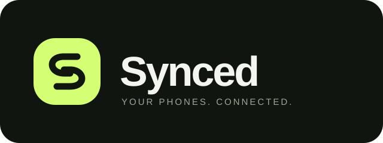

<h1 align="center">Synced</h1>

Your other phone. Within reach.

Synced is a **React Native and TypeScript** Android app for viewing and operating a second Android phone over local Wi-Fi or a personal hotspot. Install the same app on both phones, intentionally connect them, and approve access on the sharing phone.

**Development preview.** This is an implementation under validation, not a production remote-access guarantee. Android's consent and permission boundaries apply.

## Stack

