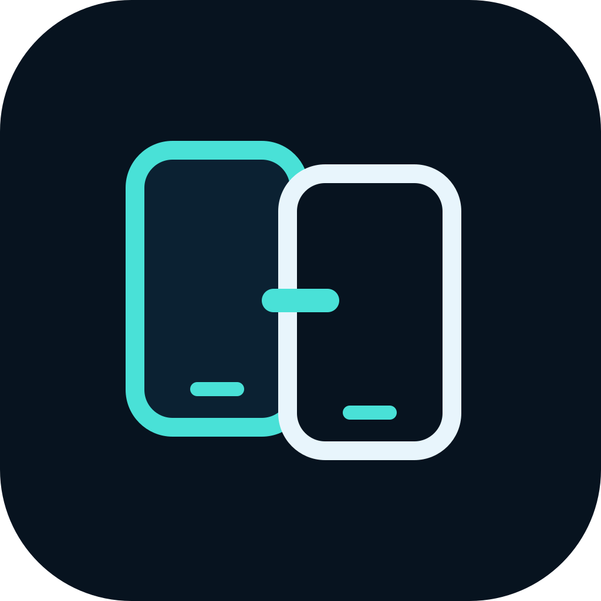

# Synced



An Android phone sharing app built with **React Native and TypeScript**. Pair two phones deliberately on the same Wi-Fi or hotspot, view the shared screen, and optionally allow remote gestures and typing.

This is a fresh restart. The earlier implementation was removed from the current branches; its history remains available. No application Java, Kotlin, custom native adapter, or Android/iOS project is maintained here. Expo generates platform projects from React Native dependency plugins during builds. Those external packages contain the platform implementation, as React Native device capabilities require.

## Current behavior

| Feature | Status |
| --- | --- |
| Same Wi-Fi / hotspot | Direct TCP pairing and WebRTC video; optional private host IP override |
| Intentional pairing | Strong per-session invitation, matching verification code, explicit host approval |
| Screen viewing | Android consent dialog, entire-screen selection, visible foreground sharing service |
| Remote input | Separate local approval and Android Accessibility permission; taps, long presses, swipes, Home/Back/Recents |
| Typing | Replaces text in one focused editable field; tap the target field first |
| Messaging apps | Operate their visible UI where Android allows; no WhatsApp/Facebook account integration |
| Alarm setup | Opens the host clock's alarm setup UI; does not claim the alarm was saved |
| Ringing alarm dismissal | Depends on the clock UI; protected system surfaces are blocked |
| Bluetooth, persistent trust, remote call audio | Not implemented |
| Game streaming | Basic touch input only; performance and game compatibility have not been established |
| iOS | Not supported by this build |

There are no seeded devices, simulated connections, mock screen frames, cloud rooms, STUN servers, or TURN relays in the application runtime. A router with client isolation may prevent a connection. Hotspot hosts sometimes need their private gateway address entered manually.

## Run on two Android phones

Requires Node 24.3+, Android SDK/JDK 17, and Android 8+ devices. **Expo Go cannot run these native dependencies.** Use an Expo development build or the CI preview APK.

```sh
npm ci
npm run android
npm start
```

1. Connect both phones to the same router, or connect one to the other's hotspot.
2. On the phone being controlled, choose **Share** and create an invitation.
3. Transfer that invitation privately to your other phone and paste it into **Connect**. It contains a session secret; do not post it publicly. Unused invitations expire after ten minutes.
4. Compare the code shown on both phones. Approve the peer on the host only if they match.
5. Start screen sharing on the host and choose **Entire screen** in Android's dialog. App-only sharing is unsuitable for device control.
6. For control, enable Synced in Android Accessibility settings, return to Synced, and separately allow the paired peer to control it. Then open the intended app or use Home.
7. Stop control, stop sharing, or disconnect from Synced when finished. Disconnect invalidates the invitation and grants. Pair again for the next session.

Rotation stops capture and requires sharing again so touches are remapped. The receiver also disables gestures when video and screen aspect ratios differ. This cannot detect every same-aspect app-only crop, so entire-screen selection remains necessary.

## Permission and security boundary

- Pairing uses a random 256-bit invitation secret, fresh nonces, HKDF direction-specific keys, AES-GCM authenticated messages, and strictly ordered replay rejection. The short displayed code is a human comparison, never the encryption key.
- Pairing, viewing, and control are separate grants. Unexpected disconnects, stopped capture, and revoked Accessibility access stop control.
- Local network signaling is bounded and encrypted. WebRTC protects video transport. There is no custom background persistence, remote unlock, camera feed, microphone capture, or stored message history.
- Remote input is blocked for unknown windows and selected sensitive system/package surfaces. Android can hide secure screens. The accessibility package does not reliably expose password metadata; **do not share password fields or sensitive apps**. Package-name checks are a conservative guard, not a security sandbox.
- An already dispatched native gesture cannot be recalled. Permission dialogs, lock screens, OEM alarm/call interfaces, battery management, and Accessibility implementations vary by device. Successful compilation does not establish compatibility with every phone.

The background capture service comes from the external WebRTC/LiveKit Expo packages. No LiveKit server, account, or hosted room is used. Reliability while controlling another app still needs testing on actual phones; Android may stop sharing when it locks or kills the process.

## Development and verification

```sh
npm run check            # source boundary, strict types, lint, behavioral tests
npm run bundle:android   # production Android JS bundle
npm run prebuild:android # generated platform output stays ignored
```

CI runs these checks and builds an ARM64 preview APK. The preview uses generated development signing and is intended for personal device testing, not store publication. See [Android workflow](.github/workflows/android.yml).

The Accessibility dependency is experimental and pinned to [upstream source](https://github.com/bedda-tech/react-native-accessibility-controller/tree/133fdaf0a61044e1c899681391b79f1845c9c2ee). Its package omits compiled JS/declarations, so `postinstall` compiles its TypeScript without changing native code. Its screenshot APIs are not used. The pinned dependency and the security protocol need independent review before a public release.

The prefixed WebRTC AAR contains an unused class-loader customization method that references an omitted generated JNI class. The Expo configuration suppresses only that exact R8 warning (`livekit.org.jni_zero.JniZeroJni`); normal initialization uses the default loader. Release optimization remains enabled. The configuration also overrides dependency labels and disclosures in generated resources so Accessibility settings identify Synced and explain local screen/control sharing correctly.

Source layout: `src/ui` contains the native screens and viewport geometry; `src/core` contains protocol, transport, media and input; `src/controller` coordinates local permissions and session state. The linked-phone logo is maintained as a vector in `assets/logo.svg`.
